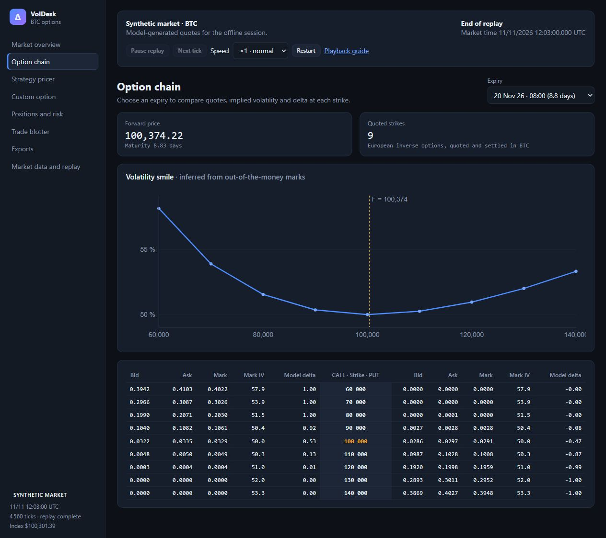

# VolDesk

VolDesk is a C# options desk for BTC and ETH. It connects the volatility smile you observe in the market to the option quote, the hedge and the risk carried by the book. It includes an offline demonstration and a public market-data feed from Deribit.

## Walk through a trade

1. Start the web app in demonstration mode and choose BTC or ETH.
2. Pick an expiry and a strike. Inspect the option chain, then price a multi-leg structure or an off-grid contract.
3. Compare the premium in USD and crypto, inspect the Greeks and add the simulated trade to the book.
4. Move the market forward to see the position and its initial hedge change. The blotter preserves the sequence of trades.

## Inside the application


The market overview shows the forward, number of strikes and implied volatility near the money for each expiry. The smile uses out-of-the-money marks. Selecting an expiry in the option chain puts call and put bids, asks, marks and model deltas on the same strike row.




On the pricer, each row is a leg. Buying a spread means paying the ask on the long call and receiving the bid on the short call. Their theoretical values can be subtracted at the same forward, while the executable cost uses the correct side of each quote. A missing side prevents simulated execution. The trade blotter records the booking and the positions view aggregates the exposure.

| Layer | What to look for |
| --- | --- |
| [Domain](src/Pricer.Domaine) | Instruments, forward pricing, implied volatility, structure quotes, Greeks and position valuation |
| [Infrastructure](src/Pricer.Infrastructure) | Market feeds, replay files, rate limits and exports |
| [Web desk](src/Pricer.Web) | Chain, strategy pricer, simulated positions and market scenarios |
| [Console](src/Pricer.App) | A second entry point to the same pricing and booking logic |

The screenshots are from a running offline BTC session. The numerical example below fixes its own strikes, maturity and volatility so you can study those effects separately.

## Implementation

I used a BTC call spread to check whether the displayed premium and hedge agree leg by leg. The example buys one call struck at USD 100,000 and sells one struck at USD 110,000. Both expire in 30 days. The futures price is USD 100,000, annual volatility is 60% for both strikes and the interest rate is zero. The dotted lines mark the two strikes.


### From the futures price to the hedge

For each European call let $F$ be the expiry's futures price, $K$ its strike, $T=30/365$ its remaining life in years and $\Phi$ the standard normal cumulative distribution function. At the desk's zero rate the Black-76 call value $C$ is in USD, and its futures delta is $\partial C/\partial F$.

```math
d_1=\frac{\log(F/K)+\tfrac12\sigma^2 T}{\sigma\sqrt T},\qquad d_2=d_1-\sigma\sqrt T
```

```math
C=F\Phi(d_1)-K\Phi(d_2),\qquad \Delta=\Phi(d_1)
```

| Position | Signed model value (USD) | Signed futures delta (BTC) |
| --- | ---: | ---: |
| Buy the 100,000 call | 6,853.94 | 0.53427 |
| Sell the 110,000 call | −3,270.26 | −0.31987 |
| Call spread | **3,583.68** | **0.21440** |

The desk divides the USD value by $F$ to express the spread premium in BTC, giving **0.03584 BTC**. Near this forward, a USD 100 rise adds about USD 21.44 to the unhedged spread at fixed volatility. Selling 0.21440 BTC of futures offsets that first-order exposure at entry. The model values in the table use a single volatility. A simulated purchase uses the two executable quote sides shown above. [Black-76 and Greeks](src/Pricer.Domaine/Pricing/Black76.cs) · [Multi-leg quotes](src/Pricer.Domaine/Pricing/PricerStructure.cs)

### How the desk handles an unquoted strike or expiry

A quoted premium implies the volatility that makes the model price equal the quote. The solver tries Newton's method and falls back to bisection when the step is unusable. For an unquoted strike, the desk interpolates each smile in log-moneyness, $\log(K/F)$. Between two expiries it interpolates total variance $w=\sigma^2T$ at the same log-moneyness and converts back to $\sqrt{w/T}$. The simulated book uses an initial hedge and excludes fees and order-book depth. [Implied-volatility solver](src/Pricer.Domaine/Pricing/VolImplicite.cs) · [Smile interpolation](src/Pricer.Domaine/Pricing/Interpolateur.cs)

## Run locally

Use the .NET 8 SDK. From the repository root, run the following command.

```sh
dotnet run --project src/Pricer.Web
```

Open the local address printed by ASP.NET Core. The default session generates a synthetic market. The replay fixture in `data/replays` was generated by the same model.

```sh
dotnet test DeribitPricer.sln --configuration Release
```

Tom Bussard
