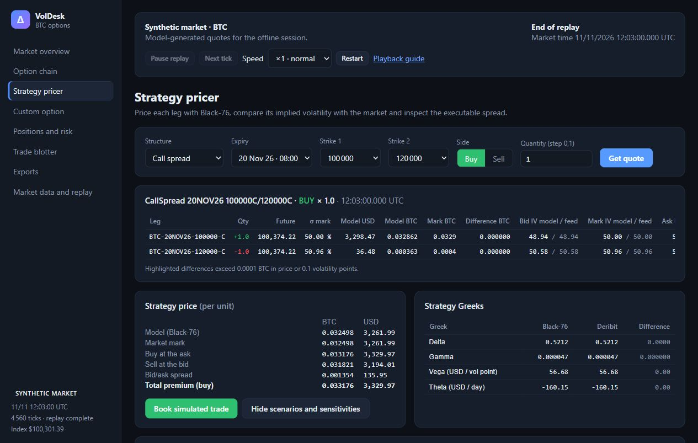
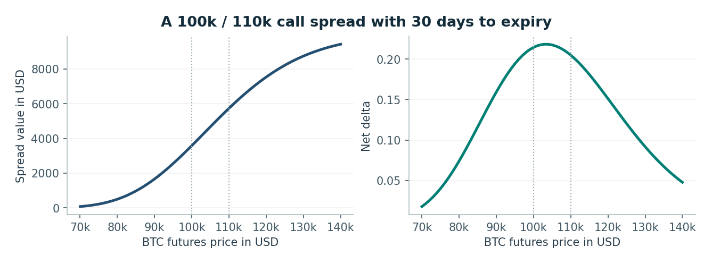

# VolDesk

VolDesk is a C# options desk for BTC and ETH. It connects the volatility smile you observe in the market to the option quote, the hedge and the risk carried by the book. It includes an offline demonstration and a public market-data feed from Deribit.

## Walk through a trade

1. Start the web app in demonstration mode and choose BTC or ETH.
2. Pick an expiry and a strike. Inspect the option chain, then price a multi-leg structure or an off-grid contract.
3. Compare the premium in USD and crypto, inspect the Greeks and add the simulated trade to the book.
4. Move the market forward to see the position and its initial hedge change. The blotter preserves the sequence of trades.

## Inside the application


The market overview shows the forward, number of strikes and implied volatility near the money for each expiry. The smile uses out-of-the-money marks. Selecting an expiry in the option chain puts call and put bids, asks, marks and model deltas on the same strike row.




On the pricer, each row is a leg. Buying a spread means paying the ask on the long call and receiving the bid on the short call. Their theoretical values can be subtracted at the same forward, while the executable cost uses the correct side of each quote. A missing side prevents simulated execution. The trade blotter records the booking and the positions view aggregates the exposure.

| Layer | What to look for |
| --- | --- |
| [Domain](src/Pricer.Domaine) | Instruments, forward pricing, implied volatility, structure quotes, Greeks and position valuation |
| [Infrastructure](src/Pricer.Infrastructure) | Market feeds, replay files, rate limits and exports |
| [Web desk](src/Pricer.Web) | Chain, strategy pricer, simulated positions and market scenarios |
| [Console](src/Pricer.App) | A second entry point to the same pricing and booking logic |

The screenshots are from a running offline BTC session. The numerical example below fixes its own strikes, maturity and volatility so you can study those effects separately.

## Implementation

This example uses the project's pricing engine for a one-month call spread at 60 percent volatility. At a futures price of USD 100,000, the spread costs USD 3,584 and has a delta of 0.214 BTC. The dotted lines mark the strikes.



The domain library prices options on futures with Black-76, interpolates the volatility smile and aggregates risk across legs. The market-data layer can replay a session or subscribe to public quotes. The Blazor interface and console both use the same pricing and booking logic. The simulated book uses a zero interest rate and an initial hedge. Fees and order-book depth are outside the model.

## Run locally

Use the .NET 8 SDK. From the repository root, run the following command.

```sh
dotnet run --project src/Pricer.Web
```

Open the local address printed by ASP.NET Core. The default session generates a synthetic market. The replay fixture in `data/replays` was generated by the same model.

```sh
dotnet test DeribitPricer.sln --configuration Release
```

Tom Bussard
