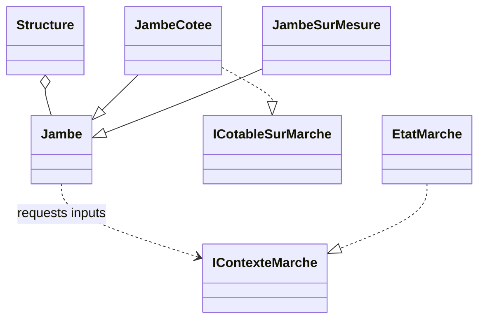
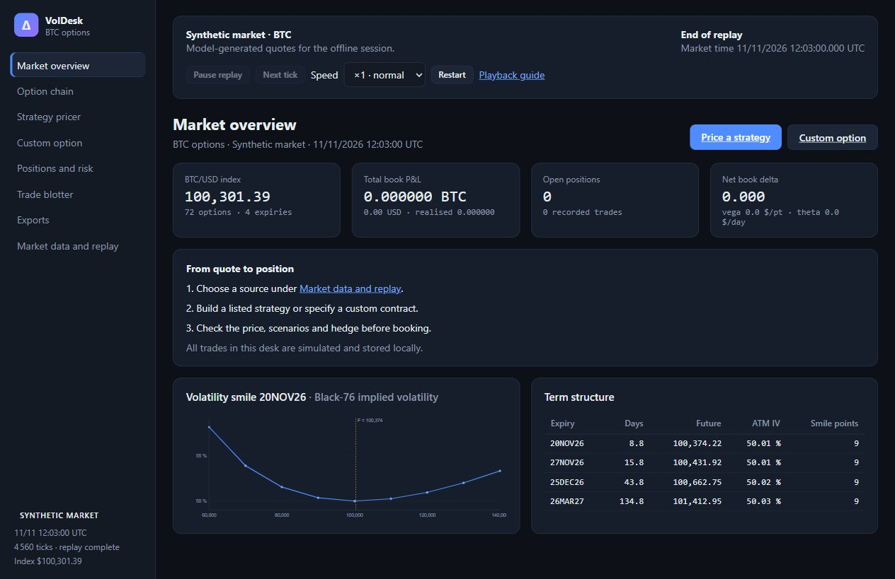
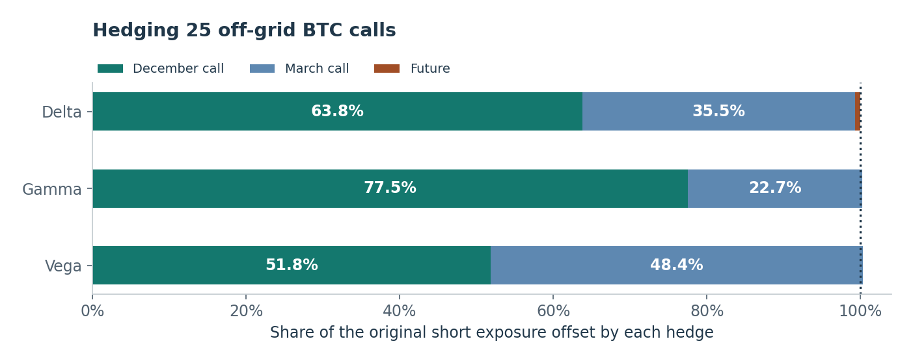

# VolDesk

VolDesk is a C# options desk for BTC and ETH. It connects the volatility smile you observe in the market to the option quote, the hedge and the risk carried by the book. It includes an offline demonstration and a public market-data feed from Deribit.

## From the option chain to the book

| Desk task | What the application does |
| --- | --- |
| Read the market | Choose BTC or ETH, load an offline demonstration, replay recorded quotes or connect to Deribit's public feed. Inspect strikes, expiries, futures, bid, mark, ask and the implied-volatility smile. |
| Quote a listed strategy | Pick a single call or put, a call or put spread, a call or put butterfly, a straddle, a strangle or a risk reversal. Inspect the signed legs, theoretical value, executable sides and Greeks. |
| Quote an off-grid option | Choose a free strike and maturity within the market surface. Inspect the two bracketing smiles, then select two listed hedge options manually or let the desk search for a pair. |
| Carry a position | Book a simulated trade, inspect the timestamped blotter, revalue the open book and inspect realised and unrealised P&L and risk by maturity. The scenario views show today's value, expiry P&L, delta and vega as the underlying moves. |
| Review a session | Pause, step through or change replay speed, then export trades, positions, results and expiry risk in CSV, Excel or JSON. |

The listed spread below explains execution. The [worked OTC trade](#hedging-an-off-grid-call) shows interpolation, gamma and vega hedging, quantity rounding and the client quote on one frozen market.

## Object-oriented design of the desk

The main pricing object is a `Structure` containing signed legs. Its abstract leg class, `Jambe`, defines the option payoff and asks each concrete leg for its market parameters. A listed leg (`JambeCotee`) finds the expiry forward and option quote. A custom leg (`JambeSurMesure`) obtains its parameters by interpolating the surrounding smiles. Both feed the same Black-76 calculation. Only the listed leg implements the interface for obtaining an exchange quote. [Leg hierarchy](src/Pricer.Domaine/Structures/Jambe.cs) · [Structure](src/Pricer.Domaine/Structures/Structure.cs)



A price request depends on `IContexteMarche` for the clock, instrument catalogue, quotes, futures and smiles. The infrastructure layer supplies market observations. In a test I can provide a frozen `EtatMarche` and clock to the same quote and hedge routines that the Blazor desk calls. The reproducible OTC trade below uses exactly that path. I can inspect the theoretical quote, the execution recorded in the blotter and the current mark used by the book at different points in the same session. [Market interface](src/Pricer.Domaine/Marche/IContexteMarche.cs) · [Market state](src/Pricer.Domaine/Marche/EtatMarche.cs) · [Structure pricer](src/Pricer.Domaine/Pricing/PricerStructure.cs) · [Blotter](src/Pricer.Domaine/Booking/Blotter.cs)

## Walk through a trade

1. Start the web app in demonstration mode and choose BTC or ETH.
2. Pick an expiry and a strike. Inspect the option chain, then price a multi-leg structure or an off-grid contract.
3. Compare the premium in USD and crypto, inspect the Greeks and add the simulated trade to the book.
4. Move the market forward to see the position and its initial hedge change. The blotter preserves the sequence of trades.

## Inside the application



The market overview shows the forward, number of strikes and implied volatility near the money for each expiry. The smile uses out-of-the-money marks. Selecting an expiry in the option chain puts call and put bids, asks, marks and model deltas on the same strike row.


On the pricer, each row is a leg. Buying a spread means paying the ask on the long call and receiving the bid on the short call. Their theoretical values can be subtracted at the same forward, while the executable cost uses the correct side of each quote. A missing side prevents simulated execution. The trade blotter records the booking and the positions view aggregates the exposure.

| Layer | What to look for |
| --- | --- |
| [Domain](src/Pricer.Domaine) | Instruments, forward pricing, implied volatility, structure quotes, Greeks and position valuation |
| [Infrastructure](src/Pricer.Infrastructure) | Market feeds, replay files, rate limits and exports |
| [Web desk](src/Pricer.Web) | Chain, strategy pricer, simulated positions and market scenarios |
| [Console](src/Pricer.App) | A second entry point to the same pricing and booking logic |

The screenshots are from a running offline BTC session. The numerical example below fixes its own strikes, maturity and volatility so you can study those effects separately.

## Implementation

I used a BTC call spread to check whether the displayed premium and hedge agree leg by leg. The example buys one call struck at USD 100,000 and sells one struck at USD 110,000. Both expire in 30 days. The futures price is USD 100,000, annual volatility is 60% for both strikes and the interest rate is zero. The dotted lines mark the two strikes.


### From the futures price to the hedge

For each European call let $F$ be the expiry's futures price, $K$ its strike, $T=30/365$ its remaining life in years and $\Phi$ the standard normal cumulative distribution function. At the desk's zero rate the Black-76 call value $C$ is in USD, and its futures delta is $\partial C/\partial F$.

```math
d_1=\frac{\log(F/K)+\tfrac12\sigma^2 T}{\sigma\sqrt T},\qquad d_2=d_1-\sigma\sqrt T
```

```math
C=F\Phi(d_1)-K\Phi(d_2),\qquad \Delta=\Phi(d_1)
```

| Position | Signed model value (USD) | Signed futures delta (BTC) |
| --- | ---: | ---: |
| Buy the 100,000 call | 6,853.94 | 0.53427 |
| Sell the 110,000 call | −3,270.26 | −0.31987 |
| Call spread | **3,583.68** | **0.21440** |

The desk divides the USD value by $F$ to express the spread premium in BTC, giving **0.03584 BTC**. Near this forward, a USD 100 rise adds about USD 21.44 to the unhedged spread at fixed volatility. Selling 0.21440 BTC of futures offsets that first-order exposure at entry. The model values in the table use a single volatility. A simulated purchase uses the two executable quote sides shown above. [Black-76 and Greeks](src/Pricer.Domaine/Pricing/Black76.cs) · [Multi-leg quotes](src/Pricer.Domaine/Pricing/PricerStructure.cs)

### How the desk handles an unquoted strike or expiry

A quoted premium implies the volatility that makes the model price equal the quote. The solver tries Newton's method and falls back to bisection when the step is unusable. For an unquoted strike, the desk interpolates each smile in log-moneyness, $\log(K/F)$. Between two expiries it interpolates total variance $w=\sigma^2T$ at the same log-moneyness and converts back to $\sqrt{w/T}$. The simulated book uses an initial hedge and excludes fees and order-book depth. [Implied-volatility solver](src/Pricer.Domaine/Pricing/VolImplicite.cs) · [Smile interpolation](src/Pricer.Domaine/Pricing/Interpolateur.cs)

## Building an implied-volatility surface

A market quote arrives in crypto. I first convert its premium $p$ to USD using the futures price $F$ for that expiry. To infer its volatility I solve $C(\sigma)=Fp$ (or the equivalent put equation). At zero rates a call must lie strictly between its intrinsic value and $F$ for this inversion. For the Newton step I use raw vega, the derivative per unit of decimal volatility.

```math
\nu_{\rm raw}=F\phi(d_1)\sqrt T,\qquad
\sigma_{n+1}=\sigma_n-\frac{C(\sigma_n)-Fp}{\nu_{\rm raw}(\sigma_n)}.
```

The solver starts at 50%, checks the premium bounds and switches to bisection if vega is too small or a step leaves the allowed interval. Bid, mark and ask can therefore return different implied volatilities. For the 100,000-strike call above, entering **0.06853941 BTC** as the mark recovers **60.00%** annual volatility. [Volatility inversion](src/Pricer.Domaine/Pricing/VolImplicite.cs)

For an off-grid expiry $T$ between $T_1$ and $T_2$, I interpolate the forward first. This fixes the log-moneyness $k$ to use on **both** smiles.

```math
\lambda=\frac{T-T_1}{T_2-T_1},\qquad F_T=(1-\lambda)F_1+\lambda F_2,\qquad k=\log(K/F_T).
```

On each expiry the equivalent strike is $F_i e^k$. I interpolate the volatility between quoted strikes in log-moneyness. Holding $k$ fixed, I then interpolate total variance across time.

```math
w(T,k)=(1-\lambda)\sigma_1(k)^2T_1+\lambda\sigma_2(k)^2T_2,\qquad
\sigma(T,k)=\sqrt{w(T,k)/T}.
```

The desk checks the quoted strike range and refuses decreasing total variance across the bracketing expiries. In the January trade below, the December and March smile readings are **45.1222%** and **45.6180%**. They imply **45.3608%** at the OTC expiry and a forward of **USD 74,730.77**. [Forward and smile interpolation](src/Pricer.Domaine/Pricing/Interpolateur.cs)

## Hedging an off-grid call

A client buys **25 January BTC calls struck at USD 77,000** from the desk. I ran the public frozen-market fixture with the December 76,000 call and March 78,000 call as hedges. The desk starts short the client options. In the model, gamma and displayed vega per volatility point are

```math
\Gamma=\frac{\phi(d_1)}{F\sigma\sqrt T},\qquad \nu=\frac{F\phi(d_1)\sqrt T}{100}.
```

If $q_0=-25$ is the desk quantity, I first solve for two listed option quantities $q_1,q_2$. The future then absorbs the remaining delta. The two options must have sufficiently different ratios of vega to gamma for the system to be usable.

```math
\begin{bmatrix}\Gamma_1&\Gamma_2\\ \nu_1&\nu_2\end{bmatrix}
\begin{bmatrix}q_1\\q_2\end{bmatrix}
=-q_0\begin{bmatrix}\Gamma_0\\\nu_0\end{bmatrix}.
```

```math
q_F=-\bigl(q_0\Delta_0+\tilde q_1\Delta_1+\tilde q_2\Delta_2\bigr).
```

Here the tildes are the listed quantities **after** rounding. The desk recalculates the futures hedge with those quantities and rounds its USD notional to the trading increment. A call and a put at the same strike and expiry have the same gamma and vega, so they cannot supply two independent hedges. [Hedge solver and rounding](src/Pricer.Domaine/Pricing/MoteurCouverture.cs)

| Listed hedge | Calculated quantity | Tradable quantity |
| --- | ---: | ---: |
| December BTC 76,000 call | 15.778706 | 15.800000 |
| March BTC 78,000 call | 8.262457 | 8.300000 |
| March future, in BTC equivalent after option rounding | 0.083117 | 0.083176 |

| Desk risk | Unhedged client trade | Continuous hedge quantities | After trading increments |
| --- | ---: | ---: | ---: |
| Delta in BTC | −11.8931562 | 0 | +0.0000591 |
| Gamma in BTC per USD | −0.000696806 | 0 | +0.000001443 |
| Vega in USD per volatility point | −3,135.4319 | 0 | +9.0619 |



For a client purchase, the desk adds the cost of crossing the hedge quotes and a margin to the model premium. If $N$ is the number of client contracts and $m$ the margin in volatility points, the premium in BTC per option is

```math
p_{\rm client}=p_{\rm model}+\frac{\mathrm{hedge\ cost}_{\rm BTC}}{N}+\frac{m\nu_0}{F_T}.
```

Here the model premium is **0.06306724 BTC**, the total cost of crossing the three hedges is **0.03407236 BTC**, and the half-point margin is **0.00083913 BTC per call**. Dividing the hedge cost by 25 gives a client quote of **0.06526927 BTC per call**. Running this example prints the quantities and individual risk contributions used in the chart.

```sh
dotnet run --project examples/HedgeWalkthrough --configuration Release
```

[Runnable hedge example](examples/HedgeWalkthrough/Program.cs) · [Frozen market and quotes](tests/Pricer.Domaine.Tests/Outils/MarcheDeTest.cs)

## Execution, expiry P&L and the book

For signed leg ratios $a_j$, buying the structure crosses the ask on positive legs and the bid on negative legs. The unit buy premium in crypto is

```math
p_{\rm buy}=\sum_{a_j>0}a_j\,\mathrm{ask}_j+\sum_{a_j<0}a_j\,\mathrm{bid}_j.
```

The scenario page distinguishes today's repriced structure from its payoff at expiry. If $G(s)$ is the signed sum of USD leg payoffs and $p$ the signed total premium paid in crypto, the two expiry P&L series are related by

```math
\mathrm{P\&L}_{\rm crypto}(s)=G(s)/s-p,\qquad
\mathrm{P\&L}_{\rm USD}(s)=G(s)-ps.
```

This convention matters for a call spread. At expiry with BTC at **USD 110,000**, the 100,000/110,000 spread pays **USD 10,000**. If it was bought at the example's **model** premium of 0.0358368 BTC, the expiry value of that premium is **USD 3,942.05**, leaving **USD 6,057.95**. A booked trade uses its actual simulated execution premium. The profiler solves for break-even prices on each interval between strikes. The running book separately tracks open premium, current mark, realised P&L and exposure by expiry. [Scenario profiles](src/Pricer.Domaine/Pricing/ProfilPnL.cs) · [Trade and book valuation](src/Pricer.Domaine/Booking/Book.cs)

## Run locally

Use the .NET 8 SDK. From the repository root, run the following command.

```sh
dotnet run --project src/Pricer.Web
```

Open the local address printed by ASP.NET Core. The default session generates a synthetic market. The replay fixture in `data/replays` was generated by the same model.

```sh
dotnet test DeribitPricer.sln --configuration Release
```

Tom Bussard
